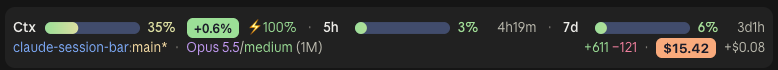
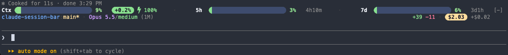

# claude-session-bar

A Claude Code mod that shows your session at a glance, in a band just above
the prompt: how full the context window is, how much of your 5-hour and 7-day
usage limits you've used and when they reset, plus the repo, model, effort,
lines changed, cost and prompt-cache hit rate.

Unlike a [status line](https://docs.claude.com/en/docs/claude-code/statusline),
which only appears in the terminal, the band draws in **both the terminal and
the Claude desktop app's Code tab**, from the same code.

**In the desktop app:**



**In the terminal:**



> [!NOTE]
> Mods are an **early-access** Claude Code feature, and their API may change
> between releases. If the band stops appearing after an update, check the
> [issues](https://github.com/NicholasDunham/claude-session-bar/issues) or
> run `claude plugin validate` on the installed folder.

## What it shows

**Meters** (the first row; the most important information):

| Meter | Shows | Note beside it |
| --- | --- | --- |
| `Ctx` | How full the context window is | How much the last turn added, as a share of the window, and the prompt-cache hit rate for the last turn |
| `5h` | Your 5-hour usage window | Time until it resets |
| `7d` | Your 7-day usage window | Time until it resets |
| `spend` | A gateway or Team spend limit, when you have one | Time until it resets |

Each bar is one fixed gradient, green at the start, yellow halfway and red at
the end, and the fill uncovers it from the left: a fuller bar shows more of it
and ends in a warmer colour. The percentage beside it takes the colour where
the fill ends. The last turn's growth (`+6.7%`) sits in a pill that warms from
green to red as the turn takes a bigger share of the window, and the cache hit
rate is green from 80%, yellow from 50% and red below.

On a wide window the meters sit side by side, spread across the row with a
faint dot between each pair; on a narrow one they stack. In the terminal the
bars are block characters; in the desktop app they're drawn as SVG. In the
terminal, Claude Code adds a `[-]` control at the right of the band that
collapses it; the desktop app has no equivalent.

**Details** (the second row):

- **Left:** the repository and branch (or the folder name outside git, and the
  worktree name inside one), then the model, effort level and context window
  size. The branch is green when the working tree is clean, and yellow with a
  `*` when it has uncommitted changes. Each model family has its own colour, and the
  effort level runs from cool (low) to hot (max).
- **Right:** lines added and removed this session, then the session's cost in
  a pill, with the last turn's share beside it (`+$0.25`). The pill is green
  under $1, then yellow, peach, and red from $20.

The colours follow your Claude Code theme: deeper tones on a light theme, and
pastels on a dark one or any other (the Catppuccin Latte and Mocha palettes).

Some values only appear once there's something real to show. The band never
shows saved or guessed numbers:

- **5h and 7d limits** come from the API's response, so a new session shows
  them after your first message.
- **Effort and cache hit rate** appear after the first turn.
- **Lines changed** counts edits Claude makes with its Edit and Write tools.
  It doesn't count changes made through shell commands, and the count is a
  close estimate rather than an exact diff.
- **Cost** is what the session would cost at API list prices. If you're on a
  Pro or Max subscription, it's notional: you aren't billed that amount, and
  your real limits are the 5h and 7d meters. It's a real cost only if you pay
  per token through the API.

## Install

You need a Claude Code version with mods support, and `git` on your `PATH` for
the branch name.

### Ask Claude to do it

In any Claude Code session, say:

> Install the session-bar mod from https://github.com/NicholasDunham/claude-session-bar

Claude will run the install command below for you.

### Or run it yourself

From a terminal session of Claude Code, type:

```
/plugin install session-bar --marketplace NicholasDunham/claude-session-bar
```

Answer `y` to add the marketplace, then press Enter to install at the **user**
scope. Or from a shell:

```bash
claude plugin install session-bar --marketplace NicholasDunham/claude-session-bar
```

The band appears in that session right away and in every session after,
including the desktop app's Code tab. (The `/plugin` command itself only
works in a terminal session; once installed, the mod loads in desktop
sessions too.)

### If you already have a status line

The band doesn't replace your status line automatically, so in the terminal
you'll see both. To keep only the band, remove the `statusLine` entry from
`~/.claude/settings.json`.

### Nerd Font glyphs

If your terminal font is a [Nerd Font](https://www.nerdfonts.com/), turn on
the `nerdFont` option for rounded ends on the bars and pills, and a bolt icon
beside the cache hit rate. It's off by default, because without a Nerd Font
those glyphs show as boxes or question marks. In a Claude Code session, run:

```
/plugin configure session-bar@claude-session-bar
```

Then run `/reload-plugins`. The option only affects the terminal; the desktop
app always draws plain shapes.

## Customizing

Everything is in four small files:

| File | What to change there |
| --- | --- |
| [`hooks/palette.ts`](hooks/palette.ts) | The light and dark palettes, the bar gradient, and the colour thresholds for growth, cost, cache hits, effort, model and branch |
| [`hooks/format.ts`](hooks/format.ts) | Bar and pill sizes and spacing, number and time formatting, model names |
| [`hooks/register.tsx`](hooks/register.tsx) | What's shown and in what order, the layout, and how often it refreshes |
| [`types/index.d.ts`](types/index.d.ts) | The shape of the values the band keeps (update it if you add one) |

If you plan to change it, install from your own clone rather than from GitHub.
Claude Code then reads the mod straight from your folder, so your edits take
effect without reinstalling:

```bash
git clone https://github.com/NicholasDunham/claude-session-bar.git ~/repos/claude-session-bar
claude plugin install session-bar --marketplace ~/repos/claude-session-bar
```

After editing, run `/reload-plugins` in a session to pick up the change. To
bring in later changes from this repo, `git pull` (or fork it and merge as you
like). Your local edits stay yours.

To work on it with live reloading instead, start a session with
`claude --plugin-dir ~/repos/claude-session-bar`: each save reloads the mod.

### Checking your changes

```bash
claude plugin validate .   # what the engine would load or refuse
claude plugin test .       # runs tests/*.test.ts on terminal and desktop
```

Claude Code writes the mod's TypeScript types into `.claude-plugin/types/` the
first time it loads the mod. After that, `tsc -p .` type-checks it. That
folder is generated, lists the MCP tools on your machine, and is in
`.gitignore`, so please don't commit it.

## Update

If you installed from GitHub:

```bash
claude plugin marketplace update claude-session-bar
claude plugin update session-bar
```

Then run `/reload-plugins` in any open session, or start a new one.

If you installed from a clone, `git pull` in the clone and run
`/reload-plugins`.

## Uninstall

```bash
claude plugin uninstall session-bar
claude plugin marketplace remove claude-session-bar
```

## License

[MIT](LICENSE)
